# Fleet project playbook: running a software project with a Claude agent fleet

**Status:** v0.1, seeded 2026-11-24 from the recruiter-assistant job-page redesign
([first project run under it](../plans/2026-11-job-page-redesign/README.md)). It evolves by
retrospective (§9), not by rewriting.

This repo already says **how code is verified**: CLAUDE.md's gates and hand-over rule,
[SUBAGENT_MODEL_POLICY.md](../SUBAGENT_MODEL_POLICY.md), and
[process/HARNESS_LESSONS.md](../process/HARNESS_LESSONS.md). This playbook covers the layer above:
**how a human runs a project through a fleet**. That means who decides what, the shape of a plan, how
estimates are made and checked, and where the human must be in the loop.

## 1. Roles

| Role | Who | Owns | Never does |
|---|---|---|---|
| **Product owner (PO)** | the human | What gets built and in what order. Every consent point (§4). Acceptance. | Verifies code line by line. That is the gates' job. |
| **Coordinator** | the main Claude Code session | The plan, dispatching agents, **independently verifying every agent report**, reporting status in plain language, recording actuals | Trusts a claimed green; pushes, merges or deploys without consent; does production work an agent should do |
| **Planner** | `planner` agent | Breaking work into slices with a TDD order and a written contract | Writes code |
| **Tester** | `tester` agent | Red: failing tests that encode the spec, including *rewriting* tests whose spec changed | Writes implementation |
| **Coder** | `coder` / `data-pipeline` | Green: the minimum implementation, iterated until the gates pass | Edits tests. If a test is provably wrong, it reports that instead. |
| **Reviewer / Security** | `reviewer`, `security` (opus, merge-blocking) | An adversarial read of the diff, with findings ranked by severity | Fixes what they find |
| **Docs** | `docs` | ADR amendments, guides, ROADMAP, HANDOFF | Commits. The coordinator commits after reading the diff. |
| **Explorers** | `Explore`, `general-purpose` | Inventories, mockups, research | Changes product code |

Agent definitions live in `.claude/agents/*.md`. Model tiers follow SUBAGENT_MODEL_POLICY: cheap
producers, strong verifiers.

## 2. Lifecycle

```mermaid
flowchart LR
  I[Intake<br/>user report or request] --> D[Discovery<br/>inventory what exists]
  D --> O[Options<br/>2-3 + recommendation<br/>+ visual]
  O -->|H1 PO decides| P[Plan<br/>slices, DoD, estimate]
  P --> B[Build<br/>per slice: red → green<br/>coordinator verifies]
  B --> R[Review<br/>reviewer + security]
  R -->|findings| B
  R --> HO[Hand-over<br/>smoke, doctor,<br/>by-hand drive]
  HO -->|H3 consent| PR[PR → CI → merge]
  PR -->|consent| DEP[Deploy<br/>flagged if user-visible]
  DEP --> UAT[UAT with real users]
  UAT --> RET[Retro<br/>actuals vs estimate]
```

The two arrows that skip ahead are **not allowed**:

- Build → PR without Hand-over. A green suite has repeatedly not meant a working product here.
- Discovery → Build without Options. A non-trivial change with no visible alternatives turns the PO
  into a reviewer of a fait accompli.

## 3. Definition of Done (per slice, and for the project)

A slice is done when:

1. The red commit exists and fails for the stated reason **only**. The coordinator re-greps the log.
2. The green commit passes `./scripts/verify.sh`, or `all` when the change touches
   `models/ api/ services/ worker/`, with the evidence pasted.
3. No test was edited in green. Any test whose spec changed was rewritten in red by the tester and
   listed in the slice contract.

The project is done when every slice is done, plus:

- Review is clean (major findings fixed, minor and nit recorded per CLAUDE.md §1).
- Hand-over evidence is pasted: smoke, doctor, and a **by-hand drive of the feature's own path**.
  Anything not driven is stated as not driven.
- Docs are updated, the PR is merged with consent, and the change is deployed and confirmed on the
  live box.
- The PO or the real users have accepted it in UAT.

## 4. Consent points (the human is always in these loops)

These are hard-to-reverse or outward-facing actions. The coordinator asks, and approval given for one
does not carry over to the next:

| Action | Why |
|---|---|
| Push / open a PR | It publishes work |
| Merge | It changes `main` for every future session |
| Deploy to a box with users | It changes what real people see |
| Anything destructive (wipe, purge, delete) | Irreversible. Ask for the scope as a question with options, never assume it. |
| Turning on egress or a new external dependency | ADR-046 class: the PO owns the risk |

Everything else, such as dispatching agents, running gates or editing on a branch, runs without
asking. **Stopping to ask about routine work is a cost too.**

## 5. Estimating

The unit of estimation is the **slice cycle**: red, green and coordinator verification. Estimate in
cycles, then convert with measured baselines, and **record the actuals in the plan** (each plan has an
"Actuals" table) so the baselines improve.

**Baselines measured in this repo (2026-11):**

| Quantity | Measured | Source |
|---|---|---|
| Full unit gate (`verify.sh`) | ~39 min | every gate log this month |
| Integration gate | ~12–14 min | same |
| CI on a PR | ~10 min | PR #114, #115 |
| Red step | ~1 h | decision record, round 1 |
| Green step | 1 h 47 m – 1 h 51 m | decision record S1-S3, S4, round 1 |
| **One cycle, wall clock** | **2.5–3 h** | the above |
| Review rounds per feature | 1 (decision record) to 3 (interview questions) | git log |
| Producer tokens per step | ~100–130k | red 106k, green 130k |

**Rules of thumb:**

- Elapsed time is **cycles × 3 h, plus human turnaround at each checkpoint**. Turnaround usually
  dominates. A checkpoint answered in an hour keeps the fleet busy, while one answered tomorrow costs a
  day.
- Cycles run one at a time. They share one Docker host, and parallel gates make the testcontainers
  flake worse. Planning, docs and mockups overlap with cycles; slices don't.
- Budget review rounds explicitly (1–2). A plan with zero review rounds is a plan to be late.

## 6. The plan document (template)

Every non-trivial project gets `docs/plans/<yyyy-mm>-<slug>/README.md` with these sections, in this
order:

1. Status table: status, PO, coordinator, links to the visual and to this playbook.
2. Problem: **quoted from the user**, plus the evidence.
3. Inventory: what exists today, with file:line anchors.
4. Options: 2–3 options, one recommended, each with its weakness stated.
5. Impact: a table of what each option touches. Say plainly where there is "none".
6. Slices: content, and which fleet roles do each.
7. Rollout: how it reaches users without disrupting them, usually a default-off flag.
8. Open questions: each with a **recommended default**, so silence is still an answer.
9. Estimate: cycles to hours to elapsed time, plus PO time.
10. Human checkpoints: ID, when, the decision needed, and what the PO looks at.
11. Risks: likelihood and a mitigation that names a test or a check.
12. Actuals: filled in as slices land.

A visual (mockups or a diagram) goes beside it **as a local file**. Nothing is published.

## 7. Coordinator rules that cost something to learn

Each of these comes from an incident on this project:

- **Verify every agent report yourself.** Re-grep the gate log and run `git show --stat`. A report is
  a claim, not evidence. This caught a subagent's mistyped stat line on 2026-11-24.
- **Check your own numbers before handing them over.** The first draft of the redesign estimate said
  1.5–2.5 h per cycle; the commit timestamps said 2.5–3 h.
- **"Ready to test" means the tester can reach the feature.** After a clean slate, résumé upload was
  invisible because every job was a parsing draft, and the PO reasonably thought the feature had been
  deleted. Before handing a box over, walk the path a *new* user takes from an empty state.
- **A config flag is only on if the process that reads it sees it.** `TALEO_ENABLED=true` reached the
  API and not the worker. Check the flag inside the process that acts on it.
- **Test the tool chain as well as the product.** A by-hand drive "accepted" a zero-width character
  because Git Bash had turned it into `?`. Before calling a surprising result a product bug, confirm
  the input actually arrived.

## 8. Status reporting to the PO

- Lead with the state: done, blocked on you, or in progress with an ETA.
- Report evidence as numbers from real output, such as `8592 passed`. "Tests pass" is not enough.
- Report what was **not** checked with the same prominence as what was.
- Each question ends with a **recommended answer**, so the PO can reply "yes".

## 9. Retrospective

At project close, append one paragraph to the plan:

- Estimate vs actual, and why they differed.
- Review findings per slice.
- Defects users found that the gates did not.
- What changes in this playbook as a result, with the playbook edit made in the same PR.

A rule that no incident produced doesn't get added.
